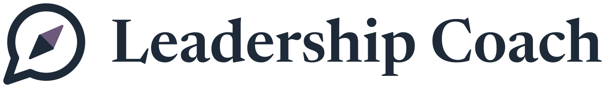
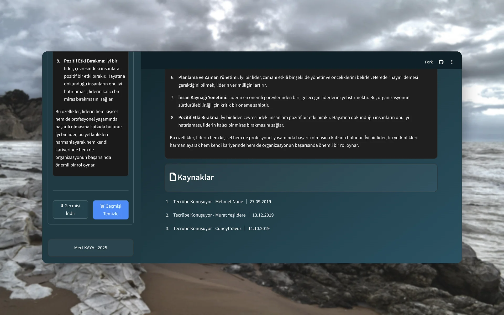

<p align="center">
  <picture>
    <source media="(prefers-color-scheme: dark)" srcset="docs/brand/svg/leadership-coach-logo-on-dark.svg">
    
  </picture>
</p>

<h1 align="center">Ask a leadership question in Turkish. Get an answer with its sources.</h1>

<p align="center">
  A Turkish-language leadership coach chatbot built with Streamlit.<br>
  <b>281 transcript chunks from 27 interviews. GPT-4o answers. Google as fallback.</b>
</p>

<p align="center">
  
  
  
  
  <a href="https://github.com/mertkayacs/Leadership-Coach-Chatbot"></a>
</p>

<p align="center">
  <a href="#quick-start"></a>
  <a href="turkish_chunks.json"></a>
  <a href="steamlit_leadership_chatbot.py"></a>
</p>

<p align="center">
  <picture>
    <source media="(prefers-color-scheme: dark)" srcset="docs/assets/readme/hero-dark.webp">
    
  </picture>
</p>

Leadership Coach is a Streamlit chatbot that answers leadership questions in Turkish. It searches 281 transcript chunks from 27 interview videos that ship in the repository, using a local multilingual embedding model and cosine similarity. GPT-4o checks whether the best matches fit the question and writes the answer with its sources. When the local content does not fit, the app falls back to a Google search.

---

## Why Leadership Coach

The app keeps retrieval small and shows where each answer comes from.

|  |  |
|---|---|
|  **Answers with sources** | Each answer lists the interview titles it was built from, as the screenshot above shows under "Kaynaklar". |
|  **No vector database** | Chunks are embedded at start-up with sentence-transformers (paraphrase-multilingual-MiniLM-L12-v2), and the top three matches by cosine similarity go to the model. |
|  **Google fallback** | When the relevance check says the local chunks do not cover the question, the app queries the Google Programmable Search API for three results. |
|  **Data you can rebuild** | The chunks file holds video title, text and source URL. Scripts for yt-dlp, Whisper transcription and chunking rebuild it from a YouTube playlist. |

## Features

**Chat**

- Turkish question box and answer view.
- Source list under every answer.
- Session history with a download button and a clear button.

**Retrieval**

- Local embeddings with scikit-learn cosine similarity, no server.
- GPT-4o relevance check, then answer generation.
- Google search fallback through LangChain.

**Data pipeline**

- audio_downloader.py, transcript_maker_whisper.py and prepare_transcripts.py build the chunks.
- The Weaviate upload scripts remain in the repository and are not used by the app.

## Quick start

```sh
git clone https://github.com/mertkayacs/Leadership-Coach-Chatbot.git
cd Leadership-Coach-Chatbot
pip install -r requirements.txt
streamlit run steamlit_leadership_chatbot.py
```

Set `OPENAI_API_KEY` for GPT-4o, plus `GOOGLE_API_KEY` and `GOOGLE_CSE_ID` (a Programmable Search Engine ID) for the Google fallback. On first load the app encodes the chunks with the local model.

### Requirements

- Python 3.11 (the version the dev container pins).
- An OpenAI API key and Google search credentials.
- A dev container configuration for Codespaces is in .devcontainer.

## FAQ

<details>
<summary><b>Which language does it speak?</b></summary>

Questions, answers and the interface are in Turkish.
</details>

<details>
<summary><b>Where do the answers come from?</b></summary>

From the 281 chunks of 27 interview videos in the repository. When none of them fits, the app searches Google and says so.
</details>

<details>
<summary><b>Do I need a database?</b></summary>

No database is needed. Embeddings are computed at start-up with a local model.
</details>

<details>
<summary><b>What are the Weaviate scripts for?</b></summary>

They are left from an earlier version. The [LeadershipGuide](https://github.com/mertkayacs/Weaviate-Based-LeadershipGuide-Chatbot) repository is the Weaviate variant.
</details>

If Leadership Coach is useful to you, a ⭐ helps other people find it.

Photos behind the screenshots are credited in [docs/assets/readme/CREDITS.md](docs/assets/readme/CREDITS.md).

[](https://github.com/mertkayacs/Leadership-Coach-Chatbot)
